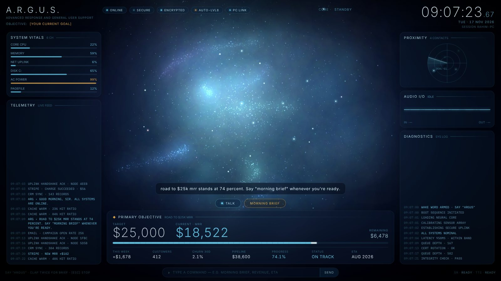
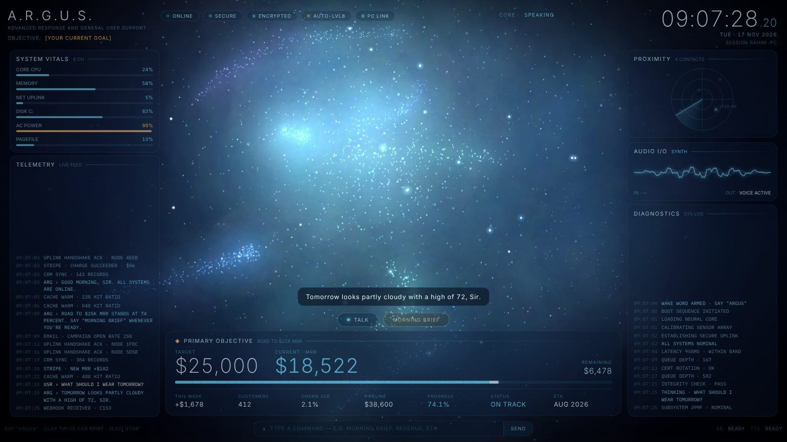

# A.R.G.U.S.

**Advanced Response and General User Support** is a personal AI voice assistant for Windows. It opens when you log in, wakes up when you say "Argus," holds a real back-and-forth conversation, and can run your PC by voice.



## What it does

| | |
|---|---|
| **Conversation** | Say "Argus" once, then keep talking. It listens for your reply after every answer and remembers the conversation until it has been quiet for 20 minutes. |
| **Morning brief** | Clap twice for the time, today's weather, what to bring, and your priorities for the day. |
| **Voice control** | Opens any installed app by name, closes windows, searches Google or YouTube, changes the volume and locks the PC. |
| **Live dashboard** | Real CPU, memory, disk and network readings, live logs, and a 3D particle nebula you can spin with the mouse. It zooms into the nebula while ARGUS speaks. |
| **Local AI** | Answers come from a model running on your own machine through [Ollama](https://ollama.com). A Claude API key is an optional upgrade. |



## Try saying

| Say | What happens |
|---|---|
| "Argus, what should I wear tomorrow?" | Uses tomorrow's forecast to suggest an outfit, then waits for your follow-up |
| "Argus, open Spotify" / "close Chrome" | Opens or closes the app |
| "Argus, search for coffee near me" | Google search |
| "Argus, play lo-fi on YouTube" | YouTube search |
| "Argus, volume up" / "mute" / "lock my computer" | System controls |
| "Argus, when was World War 2?" | Answers from the AI, Wikipedia, or Google as a fallback |
| "Argus, stop" | Cuts it off mid-sentence |
| 👏 👏 | Morning brief |

## How it works

```
Microphone ──► Dashboard (Edge, full screen) ──► PowerShell link (localhost:8080) ──► Ollama (local AI)
  wake word      shows status, speaks replies       PC vitals, approved commands         conversation brain
  clap detector                                     weather, Wikipedia lookups
```

- **`dashboard.html`** is the interface: speech recognition, wake word, double-clap detection, text-to-speech and the animated dashboard.
- **`argus.ps1`** is a small local web server written in PowerShell. It serves the dashboard, reads system stats, runs commands from an approved list, fetches weather from [Open-Meteo](https://open-meteo.com), and talks to the AI model.
- **`argus-fullscreen.bat`** starts both and opens the dashboard full screen in Microsoft Edge.

## Setup (Windows 10 or 11)

1. **Download this repo:** click **Code → Download ZIP**, then extract it somewhere permanent, like `Documents\ARGUS`.
2. **Install the AI (optional but recommended):** install [Ollama](https://ollama.com), then run this once in PowerShell:
   ```
   ollama pull llama3.2
   ```
3. **Set your city:** right-click `argus.ps1` → **Edit**, and change `$Location` near the top to your city's name, latitude and longitude. You can also edit `$Priorities` and `$DailySuggestions` there.
4. **Start it:** double-click `argus-fullscreen.bat`. If Windows says "Windows protected your PC," click **More info → Run anyway**.
5. **Open at login (optional):** double-click `add-argus-to-startup.bat` once.

Press **Alt+F4** to leave full screen. Close the minimized "ARGUS LINK" window to shut ARGUS down.

## Safety and privacy

- ARGUS can only run actions from the approved list in `argus.ps1`. It refuses to shut down or restart the PC, and it asks for clarification on vague requests like "close it."
- The local server only answers on `localhost` and rejects requests from other websites.
- With Ollama, your conversations are processed on your machine. Speech recognition is provided by the browser (Microsoft Edge or Google Chrome), which sends microphone audio to its speech service while ARGUS is listening.
- If you add a Claude API key to `argus.ps1`, don't share or commit that file.

## Troubleshooting

ARGUS writes `argus-log.txt` next to `argus.ps1`. It records what the microphone heard, what was sent to the AI, and any errors. Look for `brain=ollama` to confirm the AI is connected.

## About this project

Built by Ibrahim Bah in 2026. I designed ARGUS and directed its development using AI coding tools (Claude), then refined it through daily use: reading its logs to find what broke and fixing it, such as the microphone hearing ARGUS's own voice and treating it as a new question.

[Project page](https://cv9s.github.io/argus/)

## License

[MIT](LICENSE)
